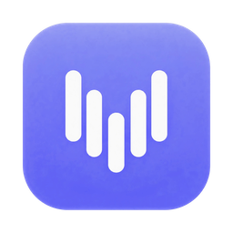
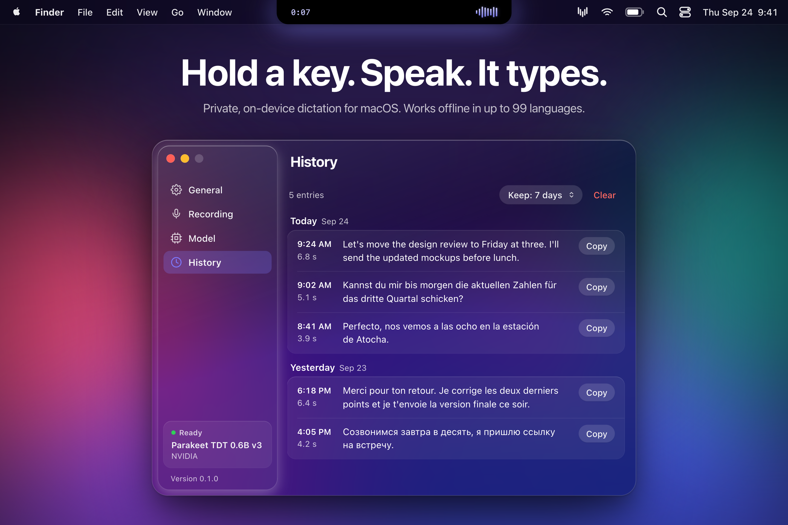
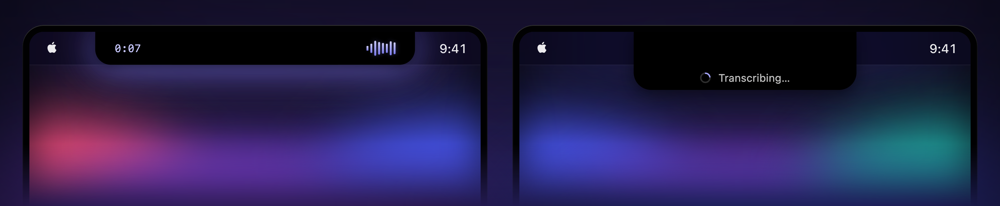

<p align="center">
  
</p>

<h1 align="center">Voxy</h1>

<p align="center">
  Push-to-talk dictation for macOS and Windows that types into any app, with speech recognition that runs on your computer.
</p>

<p align="center">
  <a href="https://github.com/DIZRAID/voxy/actions/workflows/ci.yml"></a>
  
  
  
  
  
</p>

<p align="center">
  <a href="#install">Install</a> ·
  <a href="#usage">Usage</a> ·
  <a href="#models">Models</a> ·
  <a href="docs/TROUBLESHOOTING.md">Troubleshooting</a> ·
  <a href="docs/DEVELOPMENT.md">Development</a>
</p>

<p align="center">
  
</p>

> **Early days.** Voxy is at an early version (0.1). Prebuilt releases for Apple Silicon Macs and for Windows 10/11 (x64) are on the [Releases page](https://github.com/DIZRAID/voxy/releases/latest), and one command [installs](#install) the latest one. The Windows version is new: CI builds and unit-tests it on every change, but it has had limited real-world testing so far, so reports from Windows users are very welcome ([details](#windows)).

## Install

Voxy runs on Macs with Apple Silicon and macOS 14 or later, and on x64 PCs with Windows 10 (version 1809 or later) or Windows 11. On a PC, skip to [Windows 10 and 11](#windows-10-and-11).

### macOS

#### Quick install

Paste this into Terminal:

```sh
curl -fsSL https://raw.githubusercontent.com/DIZRAID/voxy/main/install.sh | bash
```

It downloads the latest release, installs Voxy to `/Applications` and opens it. To update, run the same command again. After each update, macOS asks for Accessibility and Input Monitoring again ([why](#after-an-update)).

#### Or download

Get the `.dmg` from the [Releases page](https://github.com/DIZRAID/voxy/releases/latest), open it and drag Voxy to Applications. The build is not signed by Apple, so Gatekeeper blocks it the first time you open it. On macOS 14, Control-click (right-click) the app, choose Open, then confirm. On macOS 15 and later, try to open the app once, then go to System Settings → Privacy & Security and click Open Anyway.

To update this way, quit Voxy first (menu bar icon → Quit Voxy): only one copy can run, so a new version does not start while the old one is running. Then replace the app and see [After an update](#after-an-update).

#### Uninstall

```sh
curl -fsSL https://raw.githubusercontent.com/DIZRAID/voxy/main/install.sh | bash -s -- --uninstall
```

Besides the app, this deletes the downloaded models, settings, history and saved API keys, and removes Voxy from the privacy lists (Microphone included). To keep the models, settings, history and API keys, add `--keep-data`:

```sh
curl -fsSL https://raw.githubusercontent.com/DIZRAID/voxy/main/install.sh | bash -s -- --uninstall --keep-data
```

To remove everything by hand, see [Uninstalling Voxy](docs/TROUBLESHOOTING.md#uninstalling-on-macos).

#### Requirements

- macOS 14 Sonoma or later.
- A Mac with Apple Silicon. Intel Macs are not supported by the prebuilt release yet.
- Disk space and memory for at least one model: 44 MB to 1.04 GB on disk (see [Models](#models)). The default model takes 670 MB on disk and about 1.2 GB of RAM.

### Windows 10 and 11

Paste this into PowerShell (a normal window, no administrator rights needed):

```powershell
irm https://raw.githubusercontent.com/DIZRAID/voxy/main/install.ps1 | iex
```

It downloads the installer of the latest release, checks its SHA-256, installs Voxy for your user (in `%LOCALAPPDATA%\Voxy`) and starts it. To update, run the same command again. `iex` cannot pass options, so options need the script block form; for example, to install or update without starting Voxy:

```powershell
& ([scriptblock]::Create((irm https://raw.githubusercontent.com/DIZRAID/voxy/main/install.ps1))) -NoLaunch
```

Or download the `_x64-setup.exe` from the [Releases page](https://github.com/DIZRAID/voxy/releases/latest) and run it. The installer is not code-signed yet, so SmartScreen may say "Windows protected your PC": click More info → Run anyway. The PowerShell command does not get this warning.

#### Uninstall on Windows

Run this in PowerShell, or remove Voxy in Settings → Apps:

```powershell
& ([scriptblock]::Create((irm https://raw.githubusercontent.com/DIZRAID/voxy/main/install.ps1))) -Uninstall
```

Besides the app, this deletes the downloaded models, settings, history, the log and the saved API keys (in Credential Manager), and turns off Start with Windows. To keep the models, settings, history and API keys, add `-KeepData`:

```powershell
& ([scriptblock]::Create((irm https://raw.githubusercontent.com/DIZRAID/voxy/main/install.ps1))) -Uninstall -KeepData
```

To remove everything by hand, see [Uninstalling Voxy](docs/TROUBLESHOOTING.md#uninstalling-on-windows).

#### Requirements on Windows

- Windows 10 version 1809 or later, or Windows 11.
- An x64 PC. ARM PCs run the x64 build under emulation, so recognition is slower there.
- Microsoft Edge WebView2. Windows 11 has it, and the installer adds it if it is missing.
- Disk space and memory for at least one model, the same as on a Mac (see [Models](#models)).

Prefer to build it yourself? See [docs/DEVELOPMENT.md](docs/DEVELOPMENT.md#build-from-source), and [BUILD_WINDOWS.md](BUILD_WINDOWS.md) on Windows.

## Why Voxy

Speaking is often faster than typing. Voxy turns it into a single gesture: hold a key, say what you mean, let go, and the text is there, in your editor, a chat, an email or a browser tab. Recognition runs locally with open speech models through [sherpa-onnx](https://github.com/k2-fsa/sherpa-onnx), so your voice stays on your computer and dictation keeps working offline. If you would rather use a cloud model, bring your own API key. Everything else stays out of the way: Voxy lives in the menu bar (the notification area on Windows) and shows up as a small island while you talk, at the notch on a Mac and just above the taskbar on Windows.

- **Works in any app.** Hold Right ⌘ (Right Ctrl on Windows, or any single key you pick), speak, release. The text is pasted at the cursor of whatever app is in front. Prefer to tap instead of hold? Switch to Toggle or Dynamic mode.
- **Lives at the notch.** On MacBooks with a camera notch, the island is sized to the notch and blends into it. While you record, it widens to show a timer, a live waveform and a soft glow that follows your voice. On displays without a notch, it slides down from the top of the screen only while you record. On Windows, it rises from the bottom of the screen, just above the taskbar.
- **Private by default.** Local models run on the CPU. Audio stays in memory and is never written to disk, and once a model is downloaded, dictation works offline. No analytics, no telemetry.
- **The right model for your language.** A built-in model manager with five local models: the default covers 25 European languages; Whisper covers 99; Qwen3-ASR adds Chinese, Japanese, Korean, Arabic and Hindi; and a 44 MB model handles English only. Models come from pinned revisions, downloads resume after interruptions, and every file is verified with SHA-256. Prefer the cloud? Use OpenAI, Groq or ElevenLabs with your own API key, kept in the macOS Keychain or Windows Credential Manager.
- **Long dictation, short wait.** Long recordings are cut at pauses into pieces of about 20 seconds, and each piece is transcribed while you keep talking, so the text arrives soon after you let go. Record up to 5 minutes at a time (2 minutes by default).
- **History at hand.** Your last 50 transcriptions, grouped by day, each one click away from the clipboard. Keep them for 24 hours, 7 days (the default), 30 days or forever.
- **Light on resources.** No Dock icon, just a menu bar item (a tray icon on Windows). The local model is unloaded after 5 minutes without use (you can pick 2, 5, 15 or 30 minutes, or Never) and reloads while you speak, so recording still starts the moment you press the key.

## A closer look

<p align="center">
  
</p>
<p align="center"><sub>The island at the notch: a timer, a live waveform and a glow while you speak, then "Transcribing…" until the text is pasted.</sub></p>

## Models

Five local models ship in the built-in catalog ([`src-tauri/src/catalog.json`](src-tauri/src/catalog.json)). All of them are quantized sherpa-onnx exports that run on the CPU.

| Model | Label in the app | On disk | RAM (approx.) | Languages |
|---|---|---|---|---|
| **Parakeet TDT 0.6B v3** (NVIDIA), default | Best balance | 670 MB | 1.2 GB | 25 European languages, incl. Russian and Ukrainian; auto-detected |
| **Whisper large-v3 turbo** (OpenAI) | Most languages · Slower | 1.04 GB | 1.9 GB | 99 languages, auto-detected |
| **Qwen3-ASR 0.6B** (Alibaba Qwen) | Asian languages | 987 MB | 1.8 GB | 30 languages, incl. Chinese, Japanese, Korean, Arabic, Hindi |
| **Parakeet TDT 110M** (NVIDIA) | Fastest | 136 MB | 300 MB | English only |
| **Moonshine v2 Tiny** (Useful Sensors) | Smallest | 44 MB | 100 MB | English only |

**Which one?** Start with the default. If you speak a language Parakeet does not cover, pick Whisper or Qwen3-ASR. If you only dictate in English and want the smallest download, pick Parakeet TDT 110M or Moonshine v2 Tiny.

- For most models the download size equals the size on disk. Parakeet TDT 110M is the exception: it comes as a 108 MB archive and takes 136 MB once extracted.
- Each model keeps its own license: the Parakeet models are CC-BY-4.0, Whisper and Moonshine are MIT, Qwen3-ASR is Apache-2.0.
- **New models.** At startup, at most once a day, Voxy checks the sherpa-onnx model release on GitHub and lists up to five new models from families it can run, marked "Not rated yet". They are only listed, not installed. Models join the catalog in app updates, after testing.

**Online providers** (optional, each needs your own API key):

| Provider | Model | Languages (as listed in the app) | Price shown in the app |
|---|---|---|---|
| OpenAI | `gpt-transcribe` | Dozens of languages | ~$0.0045/min |
| Groq | `whisper-large-v3-turbo` | 99 languages | ~$0.00067/min |
| ElevenLabs | `scribe_v2` | 90+ languages | ~$0.0037/min |

Prices are the app's estimates as of September 2026. Billing is between you and the provider.

## Privacy

- **Local models:** audio never leaves your computer. It is held in memory only while it is recorded and transcribed. Voxy never writes audio to disk.
- **Online providers:** audio goes only to the provider you selected. It is sent as 16 kHz mono WAV, in pieces of up to 28 seconds.
- **API keys** are stored only in the macOS Keychain (Credential Manager on Windows). After you save a key, the app never sends it back to the Settings window; it only reports whether a key exists. Before saving, Voxy checks the key with a request that does not use any transcription minutes.
- **History** is plain text in `history.json` on your machine (see [Data locations](docs/TROUBLESHOOTING.md#data-locations)). It is kept for the period you choose, and the Clear button deletes it.
- **Clipboard:** pasting works through the clipboard, so the dictated text sits there briefly. If the clipboard held text before, that text is put back about 0.5 s later, unless you copied something else in the meantime or it was a password from a password manager. The dictated text is marked to stay out of clipboard history (Win+V on Windows), but some history tools may still record it.
- **Other network requests:** model downloads (Hugging Face and GitHub) and the once-a-day check for new models (GitHub API). That's all.

## First launch and permissions

This section is about macOS. On Windows, Voxy needs no permissions besides the microphone, and Settings opens on the first launch while the default model downloads (see [Windows](#windows)).

### First launch

1. Voxy's icon appears in the menu bar. Its menu has Settings… and Quit Voxy. If you can't see the icon (on a MacBook with a notch, a full menu bar can hide it), open Voxy again from `/Applications` to bring up Settings.
2. macOS asks for Accessibility and Input Monitoring. The Settings window opens with a banner that shows which permissions are still missing.
3. If no model is installed yet, the default Parakeet TDT 0.6B v3 (670 MB) starts downloading. Progress appears in Settings → Model. For other languages, or for a smaller download, stop the running download with the round button next to its progress, click Get next to the model you want, then click that model under Installed when it finishes. Downloading a model does not switch to it.
4. macOS asks for microphone access the first time you record. Click Allow, then dictate again.

### Permissions

macOS: System Settings → Privacy & Security.

| Permission | What it is used for |
|---|---|
| Accessibility | Pasting: sends ⌘V to the active app |
| Input Monitoring | The global hotkey. Voxy uses a listen-only event tap, so keystrokes are observed but never blocked or changed |
| Microphone | Recording; macOS asks the first time you record |

The hotkey starts working once both Accessibility and Input Monitoring are granted. You do not need to restart Voxy, because it checks every 2 seconds. The button in the Settings banner opens the System Settings page for the next missing permission: Accessibility first, then Input Monitoring.

### After an update

Each release is signed ad hoc rather than with an Apple certificate, so every version has a different code signature. macOS keeps the old Accessibility and Input Monitoring entries, but they no longer match the new version: the switch still looks on, yet the permission does not work. So after each update, Voxy needs Accessibility and Input Monitoring again. The install command clears the old entries, and macOS asks when Voxy starts.

If you update manually, clear them yourself. The installer can do it without downloading anything; it also restarts Voxy:

```sh
curl -fsSL https://raw.githubusercontent.com/DIZRAID/voxy/main/install.sh | bash -s -- --reset-permissions
```

Use the same command if the hotkey does nothing after an update. Or reset the entries with `tccutil` (`com.dizraid.voice` is Voxy's bundle identifier, and `ListenEvent` is the system name for Input Monitoring):

```sh
# Quit Voxy first (menu bar icon → Quit Voxy)
tccutil reset Accessibility com.dizraid.voice
tccutil reset ListenEvent com.dizraid.voice
open /Applications/Voxy.app
```

Voxy asks for both permissions again when it starts; switch it on in both lists. If you prefer System Settings, quit Voxy, select it in each of the two lists and remove it with the − button, then open the new version and grant the permissions (or add the app back with +).

For the same reason, macOS may ask whether Voxy can read a saved API key from the Keychain the first time after an update, sometimes with your login password. Choose Always Allow.

## Usage

1. Put the cursor in any text field.
2. Hold Right ⌘ (on Windows, Right Ctrl) and speak.
3. Release. The island shows "Transcribing…", then the text is pasted.

| Mode | Behavior |
|---|---|
| Hold (default) | Records while the key is held; releasing it transcribes |
| Toggle | Press once to start, press again to stop |
| Dynamic | A quick tap (under 1 s) starts a recording that continues until the next press. Holding for 1 s or longer works like Hold |

- **Cancel a recording:** click the island while it is recording, then click the Cancel button that appears. The audio is discarded.
- **Accidental taps:** presses shorter than the minimum duration (Settings → Recording, default 300 ms) are ignored.
- **Length limit:** when the maximum length is reached (Settings → Recording, 15 s to 5 min, default 120 s), the recording stops and is transcribed. The timer turns yellow 10 seconds before the limit and red 5 seconds before it.
- **Change the hotkey:** Settings → General → Hotkey → Change, then press the new key (Esc cancels). Voxy observes the key without blocking it, so the key still reaches the active app. A modifier or an unused function key works best; on Windows, avoid the Win keys and Left Alt ([why](#windows)).
- **Delete a model:** click the trash icon next to it in Settings → Model.
- **Other settings:** microphone, start and stop sounds, and launch at login (Start with Windows on a PC) in General; when to free the model's memory in Model.
- **Open Settings:** menu bar icon → Settings… (on Windows, click the tray icon), or launch Voxy again.
- **History:** Settings → History lists recent transcriptions, each with a Copy button. The Keep menu sets how long entries are kept, and Clear deletes them all.
- **Clipboard:** if the clipboard held text before a paste, that text is restored afterwards. Other content, such as an image, is not restored.

The island also shows short messages when something goes wrong. [Troubleshooting](docs/TROUBLESHOOTING.md#messages-on-the-island) explains what they mean.

## Windows

Voxy for Windows 10/11 (x64) does the same job as on a Mac: hold the hotkey (Right Ctrl by default), speak, release, and the text is pasted with Ctrl+V, whatever the keyboard layout. What is different:

- **Tray icon.** Voxy lives in the notification area. Click its icon to open Settings; right-click it for Settings… and Quit Voxy. Windows 11 may hide a new icon under the ^ arrow; drag it onto the taskbar to keep it in sight. On the first launch, Settings opens by itself while the default model downloads.
- **The island** stays hidden until you record. Then it rises from the bottom of the screen, just above the taskbar (where the Windows 11 volume indicator appears), and sinks away once the text is pasted. It never takes the focus from the app you are typing in.
- **The Settings window** has a dark title bar with Mica glass on Windows 11, and an opaque dark background on Windows 10.
- **No permissions.** The hotkey and pasting work without anything like macOS's Accessibility and Input Monitoring; only the microphone follows Windows privacy settings.
- **Data.** Models, settings, history and the log are in `%LOCALAPPDATA%\com.dizraid.voice`; API keys are in Credential Manager.

Known limits:

- **The installer is not code-signed**, so SmartScreen warns when you run the downloaded `.exe` (More info → Run anyway). The PowerShell command does not get this warning.
- **Apps running as administrator.** Windows does not let a normal app see keys typed into an elevated window or send keystrokes to it. While such a window is in front, the hotkey most likely does nothing, and if a dictation ends there, the island says "Paste blocked by an admin app — text kept in clipboard": press Ctrl+V yourself.
- **The Win keys and Left Alt make poor hotkeys.** A tap of Win opens the Start menu and Left Alt activates app menus; Voxy only listens to the key, so it cannot stop either. Right Ctrl or an F-key works better.

Build steps, the differences in more detail, known gaps and a testing checklist are in [BUILD_WINDOWS.md](BUILD_WINDOWS.md). Windows support is new and has had limited real-world testing, so please [report](https://github.com/DIZRAID/voxy/issues) anything that does not work, with the log from `%LOCALAPPDATA%\com.dizraid.voice\Voxy.log`.

## Roadmap

- **Notarized releases** (no Gatekeeper prompt) and **permissions that survive updates**.
- **More local models**, added to the catalog after testing.
- **Windows**: a code-signed installer (no SmartScreen warning) and a winget package.
- **A light theme** for the Settings window.

## Documentation

- [docs/DEVELOPMENT.md](docs/DEVELOPMENT.md): building from source, running and testing, previewing the UI without Tauri, adding a model, releases, project layout and stack.
- [docs/TROUBLESHOOTING.md](docs/TROUBLESHOOTING.md): logs, island messages, hotkey and paste problems, model downloads, build issues, data locations and uninstalling.
- [BUILD_WINDOWS.md](BUILD_WINDOWS.md): building on Windows, how the Windows version differs from macOS, known gaps and a testing checklist.
- [SECURITY.md](SECURITY.md): reporting a vulnerability privately, and verifying a downloaded release.

## Acknowledgements

- [sherpa-onnx](https://github.com/k2-fsa/sherpa-onnx) by the k2-fsa team runs every local model in Voxy.
- [NVIDIA Parakeet](https://huggingface.co/nvidia/parakeet-tdt-0.6b-v3) powers the default model. Thanks also to the authors of [Whisper](https://huggingface.co/openai/whisper-large-v3-turbo) (OpenAI), [Qwen3-ASR](https://huggingface.co/Qwen/Qwen3-ASR-0.6B) (Alibaba Qwen) and [Moonshine](https://huggingface.co/UsefulSensors/moonshine) (Useful Sensors).
- [Tauri](https://tauri.app) for the app shell. The main Rust crates Voxy builds on are listed in [docs/DEVELOPMENT.md](docs/DEVELOPMENT.md#stack).
- Some Settings tab icons are adapted from [Feather Icons](https://feathericons.com) (MIT, © Cole Bemis).

## License

Voxy does not have a license yet. The speech models are distributed under their own licenses (see [Models](#models)).
